# UR10e Lab: Pick, Place and Stack

**Your goal:** load a robot from GitHub, move blocks using coordinates,
and build a tower. Submit the captures and answers in [QUESTIONS.md](QUESTIONS.md).

**Final task overview** (3× speed):

https://github.com/user-attachments/assets/c2d8020c-962b-4829-ad57-9fbe4109b950

Your window layout and block positions may look different from the examples below.

## 1. Prepare the workspace

Download the robot framework and prepare Docker, which runs Ubuntu 22.04 and
ROS 2 Humble in a container.

### 1.1 Install the tools

Run this section in an **Ubuntu desktop terminal** (**Ctrl+Alt+T**).
Copy commands only, without a terminal prompt such as `xander@computer:~$`.
Skip installation if these tools already work:

```bash
sudo apt update
sudo apt install -y git docker.io docker-compose-v2 xauth
sudo systemctl enable --now docker
sudo usermod -aG docker "$USER"
```

Log out and back in after adding yourself to the Docker group.
If needed, install VS Code with `sudo snap install code --classic`.

### 1.2 Download the robot repositories

Create the workspace and download the robot packages once:

```bash
mkdir -p ~/ur10e-skills-lab/upstream
cd ~/ur10e-skills-lab
git clone https://github.com/IFRA-Cranfield/ros2_SimRealRobotControl.git upstream/ros2_SimRealRobotControl
git clone https://github.com/IFRA-Cranfield/IFRA_LinkAttacher.git upstream/IFRA_LinkAttacher
git clone --branch humble https://github.com/ros-controls/gazebo_ros2_control.git upstream/gazebo_ros2_control
```

`upstream/` stores the repositories on your computer. The `humble` branch of
`gazebo_ros2_control` matches ROS 2 Humble.

Source repositories:

- [ros2_SimRealRobotControl](https://github.com/IFRA-Cranfield/ros2_SimRealRobotControl): UR10e, gripper and MoveIt configuration.
- [IFRA_LinkAttacher](https://github.com/IFRA-Cranfield/IFRA_LinkAttacher): simulated grasp and release.
- [gazebo_ros2_control](https://github.com/ros-controls/gazebo_ros2_control): connects controllers to Gazebo joints.

### 1.3 Add the lab files

Download [lab-files.zip](lab-files.zip), then extract it into this workspace using **Files**.
Keep `upstream/`; place `src/`, `docker/` and `compose.yaml` beside it.

In VS Code's Explorer, the workspace should contain:

- `src/block_interfaces`: ROS task inputs and results.
- `src/block_skills`: the scene and robot skills.
- `docker/Dockerfile` and `docker/entrypoint.sh`: the Ubuntu and ROS environment.
- `compose.yaml`: the container's startup settings.

Open `compose.yaml`. The service is `lab`, the image is `ur10e:humble`, and
the `.:/work` volume shares your workspace with Docker. Saving an edit in
VS Code updates the same files the robot skills use.

### 1.4 Build the Docker image

Open the workspace and set your Linux account IDs:

```bash
code .
export LAB_UID=$(id -u) LAB_GID=$(id -g)
docker compose build
```

The image contains Ubuntu, ROS and the robot packages. Build it once.
This creates the image; it does not start the robot. The account IDs make
files created inside Docker belong to your Linux account.

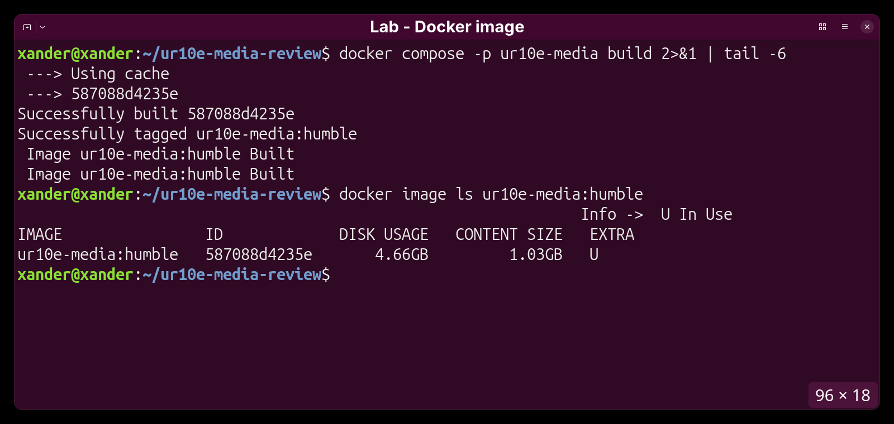

### 1.5 Give the container desktop access

Allow Docker's Gazebo and RViz windows to use your desktop:

```bash
umask 077
touch .xauth
xauth nlist "$DISPLAY" | sed 's/^..../ffff/' | xauth -f .xauth nmerge -
```

### 1.6 Enter Docker and build the skill packages

In the same terminal:

```bash
docker compose run --rm lab
```

`lab` selects the Compose service. `--rm` removes the container when you exit;
your workspace files remain on Ubuntu.

You are now at `/work` **inside Docker**. Keep this terminal open for all
remaining ROS commands; edit files in your Ubuntu VS Code window.

```bash
colcon build --base-paths src --symlink-install --parallel-workers 2
source /work/install/setup.bash
```

**Capture 1:** the build summary showing `2 packages finished`.
`source` makes these packages available in this terminal.

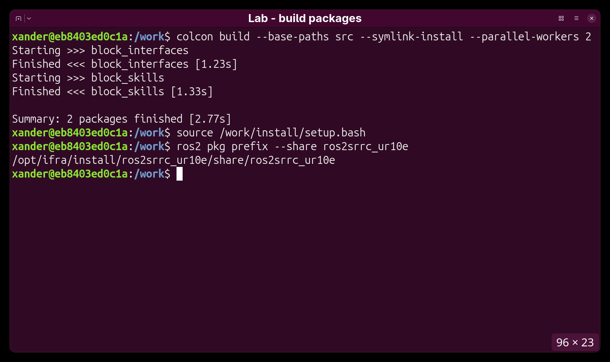

`colcon` builds the two custom packages. The IFRA robot packages are already
inside the Docker image.

## 2. Start the simulation and move joints manually

Gazebo simulates physics and moving objects. RViz shows ROS data and MoveIt
planning controls. Load the table, robot and blocks separately so you can see
what each component adds.

### 2.1 Prepare the scene settings

In VS Code, open `src/block_skills/config/blocks.json`. The `table` entry sets
the table dimensions; `blocks` contains the objects you will add later.
Keep this file open while working with the simulation.

### 2.2 Open Gazebo with the table

In the Docker terminal, start the table world:

```bash
ros2 launch block_skills world.launch.py config:=/work/src/block_skills/config/blocks.json > /tmp/world.log 2>&1 &
WORLD_PID=$!
```

**Expected:** Gazebo shows a table and floor, with no robot or blocks yet.
The table dimensions come from JSON. Wait for the table before continuing.

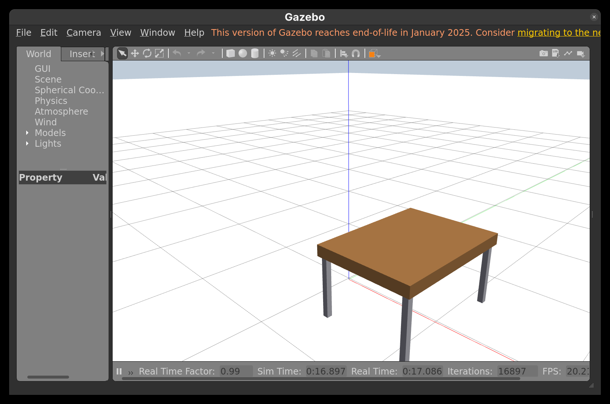

### 2.3 Start the arm, gripper and RViz

The robot stage connects the supplied UR10e model, controllers and MoveIt to
the Gazebo world. It also opens RViz with the planning controls configured.
In the same Docker terminal:

```bash
ros2 launch block_skills robot.launch.py config:=/work/src/block_skills/config/blocks.json > /tmp/robot.log 2>&1 &
ROBOT_PID=$!
ros2 run block_skills blocks status --wait 150
```

Wait for readiness before moving. Gazebo simulates the robot; RViz provides
MoveIt planning controls. `&` leaves the terminal available.

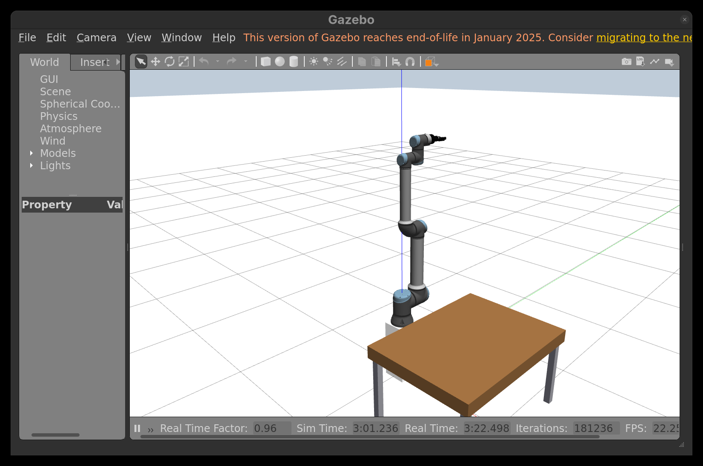


Keep both launch stages running in this shell. The PID variables let you stop
them later. Do not start `sim.launch.py` alongside them; it starts another scene.

### 2.4 Plan and move the arm in RViz

In RViz, select **Planning Group → ur10e_arm**, **Start State → current**,
then open **Joints**. Manually set all six arm joints to the same absolute
angle for each checkpoint. Leave the gripper unchanged.

| Arm joint | Checkpoint A | Checkpoint B |
| --- | --- | --- |
| `shoulder_pan_joint` | 45° | 90° |
| `shoulder_lift_joint` | 45° | 90° |
| `elbow_joint` | 45° | 90° |
| `wrist_1_joint` | 45° | 90° |
| `wrist_2_joint` | 45° | 90° |
| `wrist_3_joint` | 45° | 90° |

If the RViz input uses radians, enter **0.7854** for 45° and **1.5708** for 90°.
These are absolute goals, not increments. Complete A, then B:

1. **Manually type all six joint goals** in the Joints tab.
2. Click **Plan** and inspect the path. Gazebo's arm has not moved yet.
3. **Capture 2A-before / 2B-before:** RViz showing all six goal values and the
   planned path, with Gazebo showing the arm before execution.
4. Click **Execute** after a successful plan.
5. **Capture 2A-after / 2B-after:** Gazebo showing the executed pose; include
   RViz's current joint values in the same capture if possible.
6. Before planning B, refresh **Start State → current**.

For submission, manually enter both sets of goals and label each pair with its
angle. These poses have not been validated in this scene and may be rejected
because of collisions. If planning fails, capture the six goal values and the
planning error instead of an executed-pose capture; ask the TA before continuing.
Keep collision checking enabled and execute only successful plans.
Finish manual joint movement before loading blocks.

Before executing a movement (illustrative example; use your assigned angles):

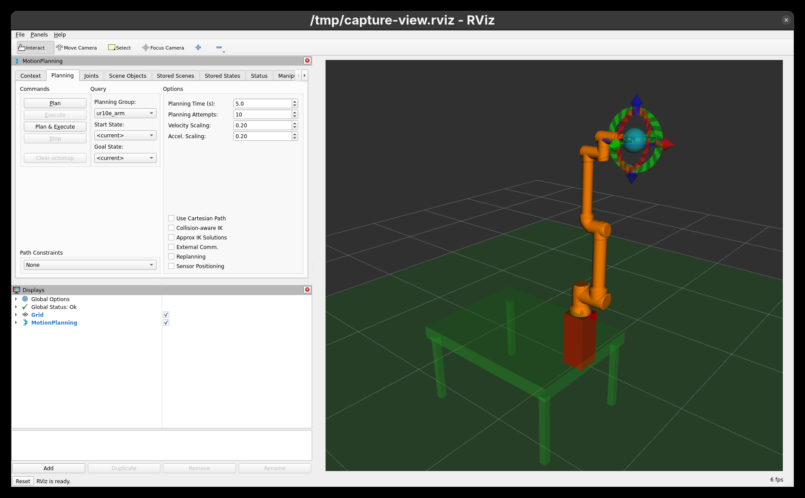

After MoveIt executes the movement:

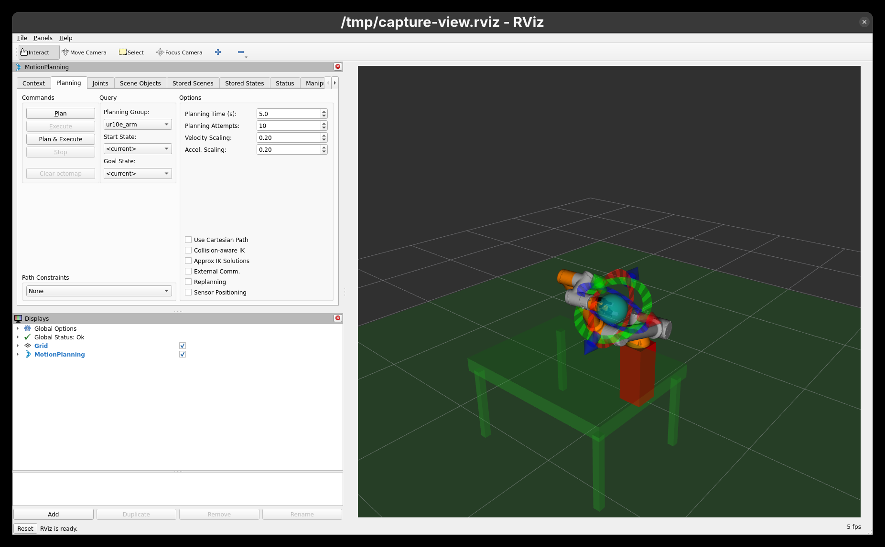

The goal model previews the requested pose; Execute sends the planned motion
to the controllers. Later, your `pick` commands send block destinations to
the same planning system instead of specifying individual joint angles.

## 3. Edit and load JSON blocks

### 3.1 Find the source files

In VS Code, look under `src/`:

- `block_skills/block_skills/cli.py`: reads your commands.
- `block_interfaces/action/PickPlace.action`: task inputs and results.
- `block_skills/block_skills/server.py`: plans and executes tasks.
- `block_skills/block_skills/geometry.py`: scene geometry and position checks.
- `block_skills/config/blocks.json`: positions, colors and motion settings.

### 3.2 Inspect and edit the block definitions

In VS Code, open `src/block_skills/config/blocks.json`. Its `blocks` list
defines each block's unique `name`, `color`, centre `position` in
metres `[x, y, z]`, and `yaw` in radians.

The starting list is:

```json
"blocks": [
  {"name": "red_block", "color": "red", "position": [0.55, -0.28, 0.675], "yaw": 0.0},
  {"name": "blue_block", "color": "blue", "position": [0.70, 0.0, 0.675], "yaw": 0.0},
  {"name": "green_block", "color": "green", "position": [0.55, 0.28, 0.675], "yaw": 0.0}
]
```

Before the first load, change green's position to `[0.65, 0.28, 0.675]` and
its palette entry to `"green": "#1AE666"`. Save the file.

Colors accept six-digit hex codes in quotes, such as `"#1AE666"`.
The supplied blocks use palette keys (`red`, `blue`, `green`); for a new block,
you can put a hex code directly in its `color` field as shown in section 6.3.
Keep JSON commas and braces intact, and save with **Ctrl+S**.

### 3.3 Load the configured blocks into Gazebo

```bash
ros2 run block_skills blocks load
ros2 run block_skills blocks list
```

**Capture 3:** the edited JSON and the three blocks in Gazebo.

**Expected:** Three blocks appear, with green at approximately
`[0.65, 0.28, 0.675]`. The server reads JSON, creates the cube models in
Gazebo, and adds their collision geometry to MoveIt. They are separate objects,
not links added to the robot URDF.


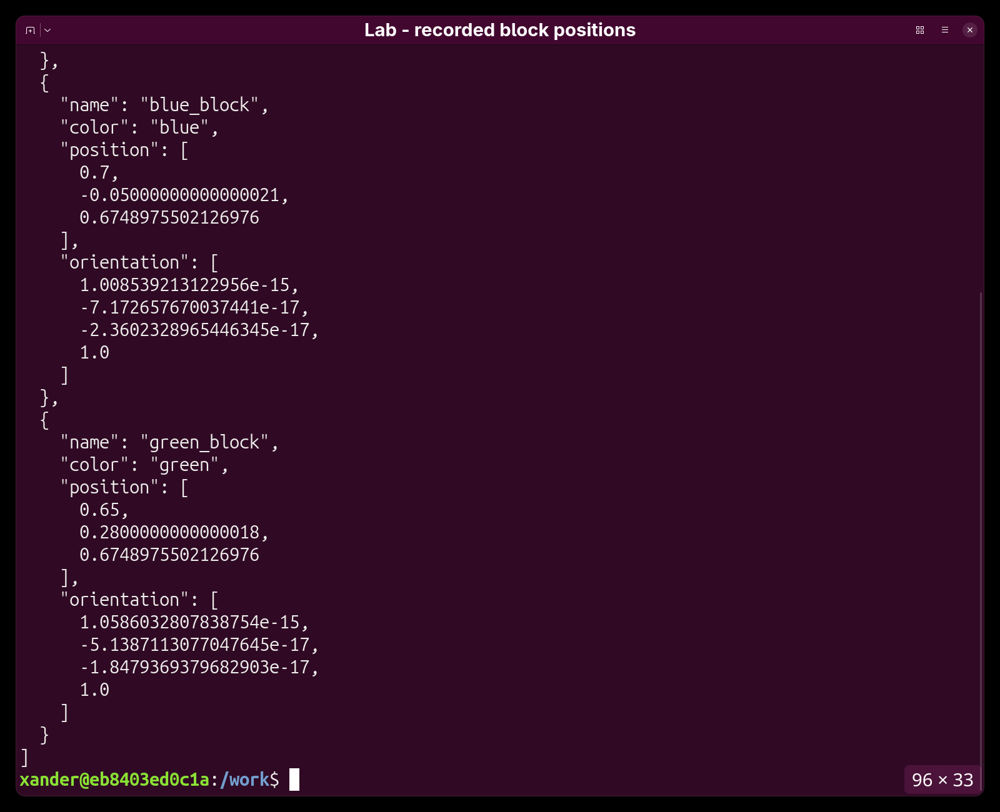

### 3.4 Changing an existing starting position

`load` adds missing model names; it preserves existing blocks' live poses.
To apply an edited starting position to an existing block, stop both stages
using section 7 (stay inside Docker), repeat sections 2.2–2.3, and load again.
Keep Z at `0.675`, stay within `workspace`, and leave at least `0.16 m`
between separate block centres.

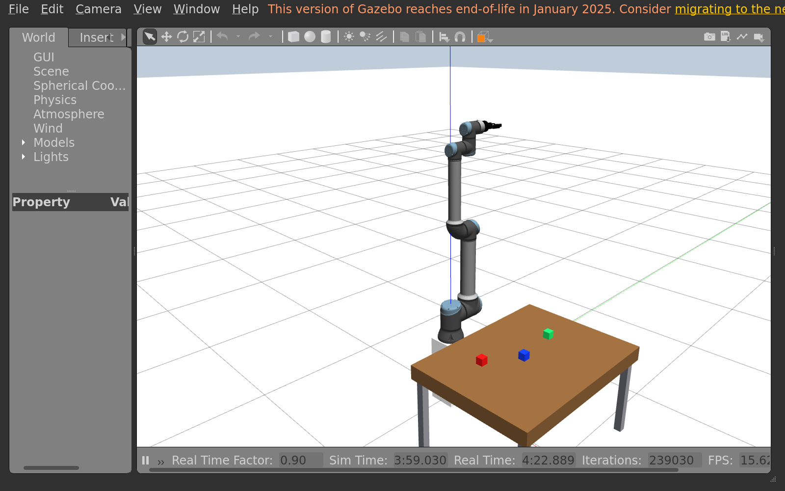

## 4. Pick and place with coordinates

### 4.1 Read the position and dimensions

Positions are `[x, y, z]` in metres. X follows Gazebo's red world axis,
Y the green axis, and Z the blue axis. Use the world axes, not the direction
the camera is facing.

The table measures **0.90 m (X) × 1.20 m (Y) × 0.10 m thick**. Its top is at
**Z = 0.65 m**. Each block is **0.05 m × 0.05 m × 0.05 m**; its centre rests
at **Z = 0.675 m**.

### 4.2 Choose a destination and run the placement

Use direct commands in Docker. For example, if the destination is clear:

```bash
ros2 run block_skills blocks pick red_block 0.82 -0.28 0.675
```

`pick` makes the robot grasp and place the named block. The last three numbers
are its destination centre **X Y Z**, in metres in the world frame.
JSON defines the starting scene; enter movement destinations directly in these
commands. No `pick_block`, `place_target` or Python wrapper is needed.

The skill gets the block's latest pose, asks MoveIt for a collision-aware path,
operates the gripper and checks the released cube. You choose the destination;
you do not need to enter six joint angles.

- X/Y are horizontal; Z is height. Use Gazebo's world axes.
- For a separate table placement, use Z = `0.675`, X = `0.38–0.95`,
  Y = `−0.45–0.45`, and at least `0.16 m` from other block centres.
- Use `ros2 run block_skills blocks list` to read current centres before choosing a target.
- Wait for `success: true` before the next move. If a failed task reports
  `holding_block: true`, ask the TA and restart the scene before continuing.

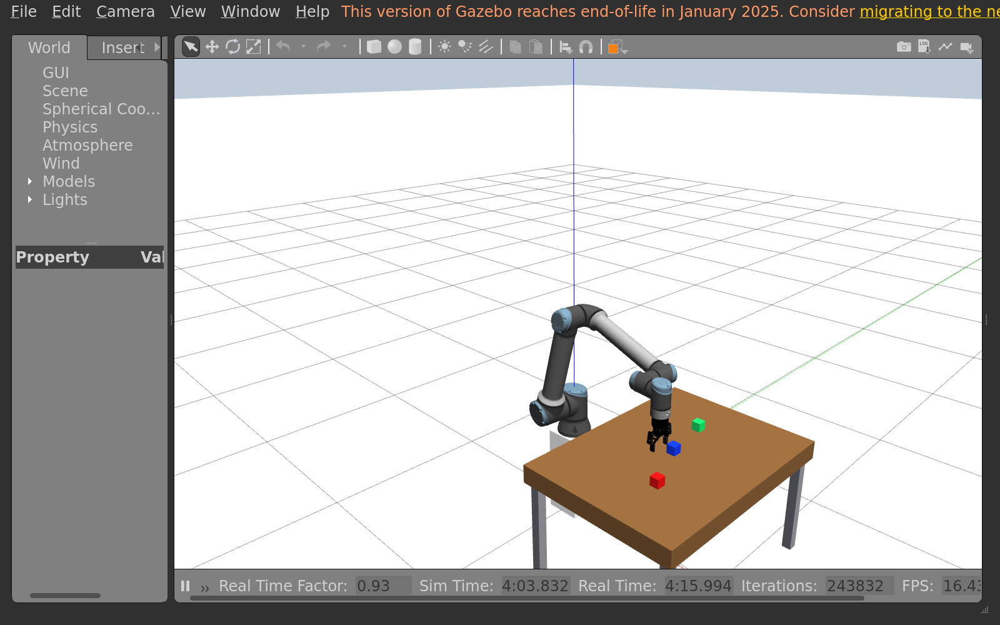

### 4.3 Move each block

Move red by changing X, blue by changing Y, and green by changing both X and Y.
Edit the model name and numeric coordinates in the command for each move.

**Capture 4:** Gazebo after the three moves. Caption it with your three commands.

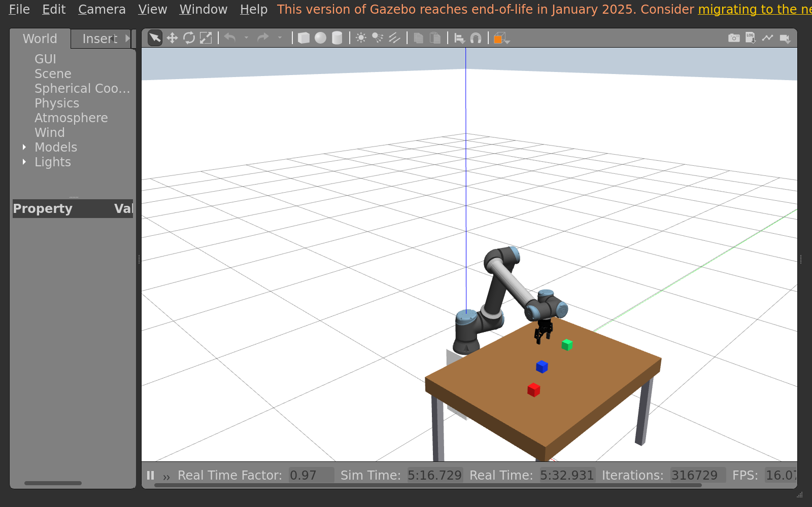

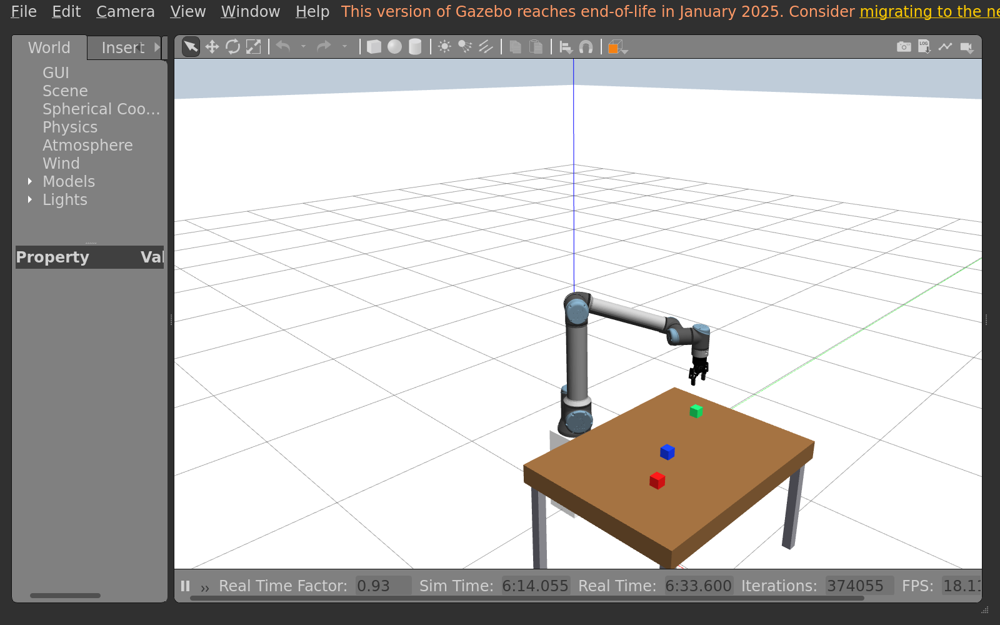

## 5. Add and move a yellow block

### 5.1 Add another block through JSON

Append this entry to the JSON `blocks` list, with a comma between entries.
Use another free position if this one is occupied:

```json
{"name": "yellow_extra", "color": "yellow", "position": [0.55, 0.12, 0.675], "yaw": 0.0}
```

Yellow already exists in `colors`. Save, then run:

```bash
ros2 run block_skills blocks load
```

**Expected:** One new yellow block appears; the existing blocks keep their
live poses. Adding a scene object does not move the robot arm.

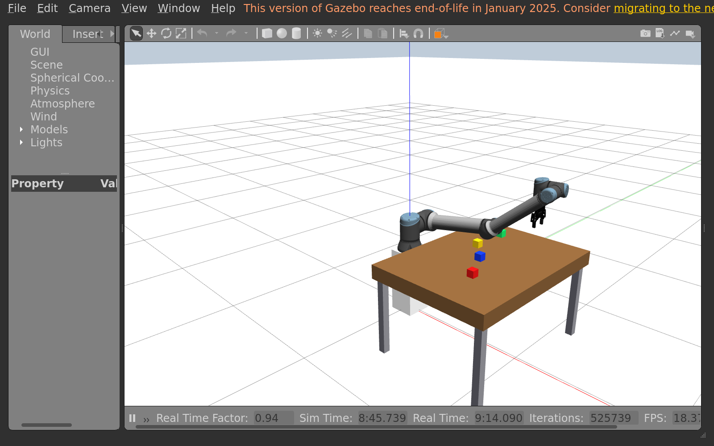

### 5.2 Move the added block

Move it to a clear table position using `pick`, for example:

```bash
ros2 run block_skills blocks pick yellow_extra 0.85 0.30 0.675
```

**Capture 5:** Gazebo showing yellow after the robot placement. Keep it separate
from the tower.

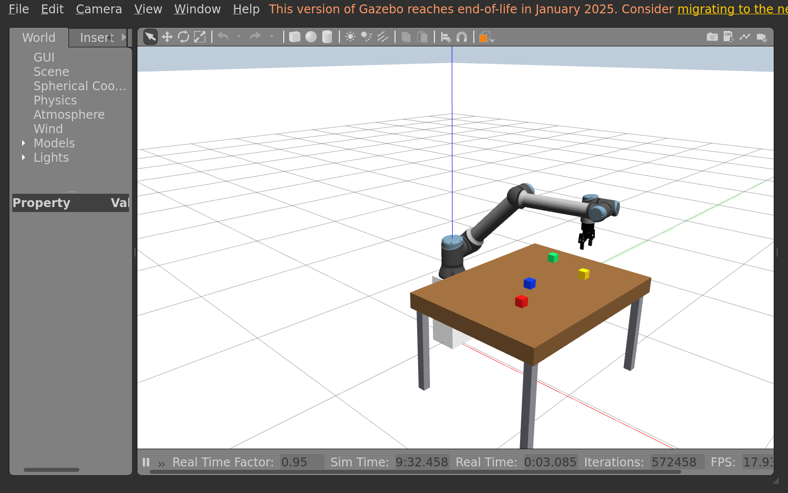

## 6. Build two towers and add your own color

### 6.1 Build a tower using coordinates

Each cube is `0.05 m` high; the table top is Z = `0.65 m`.
For stacking, align X/Y with the supporting block and calculate the moving
block's centre Z from the cube dimensions. Use `blocks list` to read live poses.

1. Keep red as the base at your chosen table position.
2. Calculate blue's centre on red, then use `pick blue_block` followed by your
   calculated X Y Z values.
3. Calculate green's centre on blue and place it with `pick green_block`.
4. **Capture 6A:** the red–blue–green tower, bottom to top. Caption it with the
   three centre coordinates and your height calculation.

Do not use the `stack` shortcut. The server checks that an elevated target
has a real, aligned support; it does not calculate or replace your coordinates.
Keep the cubes upright with yaw zero.

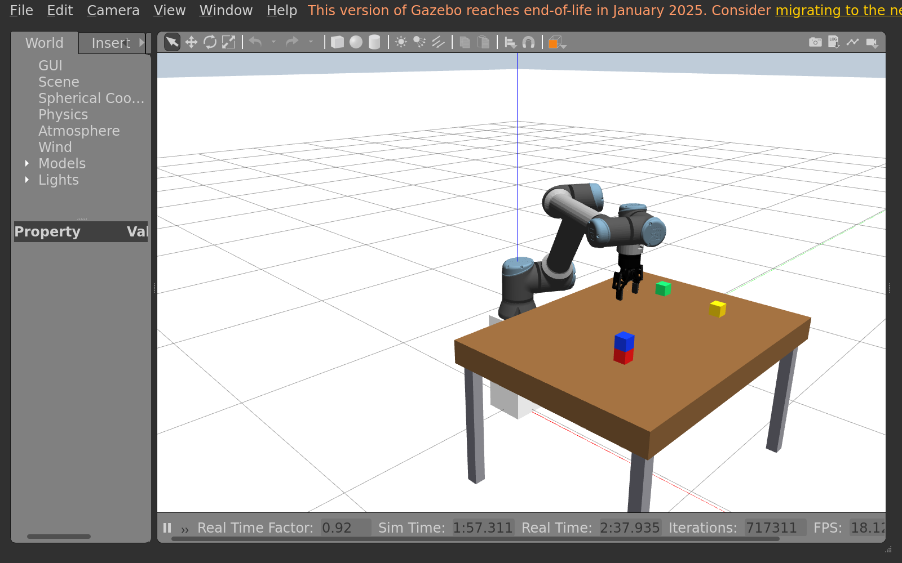

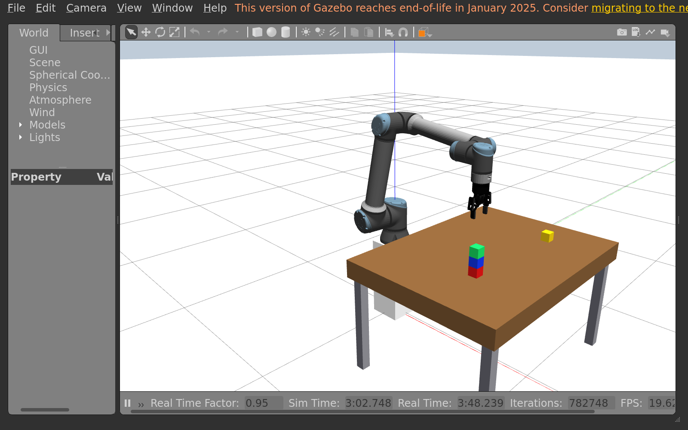

### 6.2 Build a different tower without resetting

Write the move order for a **blue–green–red** tower, bottom to top.
Move free top blocks to clear table spaces first, then rebuild using `pick`.
Complete this without resetting the scene or using `move`, `randomize`, or
the `stack` shortcut. Move only a free top block and wait for each successful
result before continuing. The order matters: a support cannot move while
another block is on top of it.

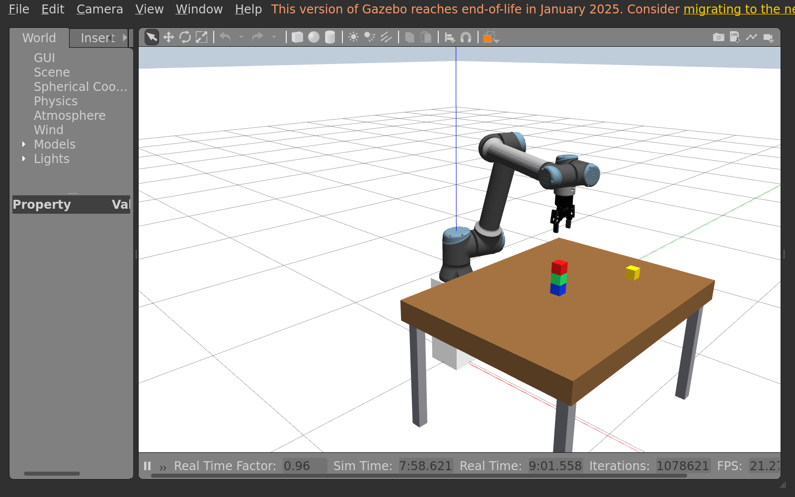

### 6.3 Add your own color beside the tower

Use the full command prefix `ros2 run block_skills blocks` for every pick.
For the final submission, add one additional block in a color **other than
red, green, blue or purple**. Specify it with a **hex color code**, not a color name.

All color and block settings are in `src/block_skills/config/blocks.json`:

1. Open an online [hex color picker](https://htmlcolorcodes.com/color-picker/),
   choose your color, and copy its **#RRGGBB** code. Each pair represents
   red, green or blue intensity. Use six digits after `#`.
2. Find the `blocks` list. Add an entry with a **unique name** and paste the
   code directly into `color`, inside double quotes. No new `colors` dictionary
   entry is needed. Keep a comma between block entries.
   `position` is its centre `[x, y, z]` in metres; use `z = 0.675` for the
   table and choose a free X/Y at least `0.16 m` from other block centres.
   For example:

```json
{"name": "custom_extra", "color": "#FF8800", "position": [0.55, -0.28, 0.675], "yaw": 0.0}
```

3. Replace `#FF8800` with your chosen code and select a free starting position.
   The yellow block from section 5 alone does not count as this additional block.
4. Save with **Ctrl+S** and load the new block in the Docker terminal:

```bash
ros2 run block_skills blocks load
```

`load` adds the new block without resetting existing objects. To recolor a
block that is already loaded, edit its `color` or palette values, then restart
both launch stages and load again as in section 3.4. Add the submission block
with a new name to preserve your completed tower.

**Capture 6B:** your blue–green–red tower with the new colored block beside it.
Include the new block entry from JSON and write your hex code in the
caption. Yellow remains separate. The configured tower limit is three cubes;
the extra color goes **beside** the tower.

## 7. Stop the simulation

In the same Docker terminal:

```bash
kill -INT "$ROBOT_PID" "$WORLD_PID"
wait "$ROBOT_PID" "$WORLD_PID"
```

Use `exit` to leave Docker when finished. Your workspace files remain on Ubuntu.
For another session, export the account IDs and prepare desktop access as in
section 1, enter Docker, source the packages, then launch the world and robot
and load the blocks again.
