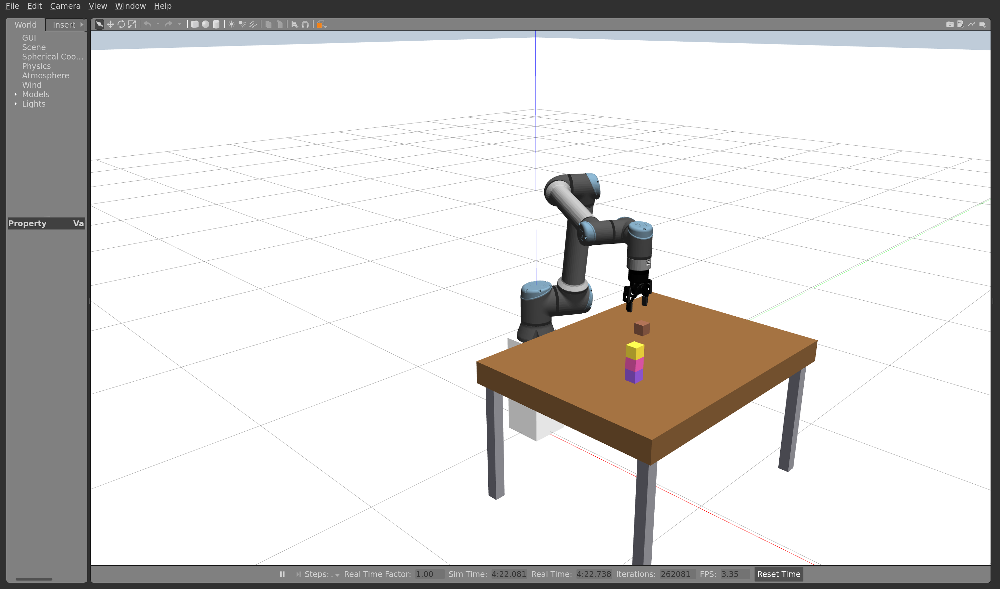
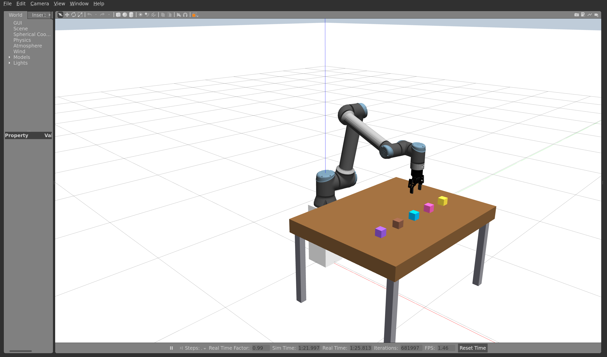

# Full tutorial test — 4 November 2026

The current tutorial completed its task sequence in a fresh workspace, using the ZIP downloaded from GitHub. All 12 pick/place requests succeeded and verified their final poses, with no unplanned reset or manual retry. The scene was restarted once as required for the color changes in Part 6.

Test workspace: `/home/xander/ur10e-tutorial-audit-20261104-154936`. Full logs, edited JSON, screenshots and per-task results remain there. The original project and the student workspace were not used as the test workspace.

## Results

| Tutorial part | Result |
| --- | --- |
| 1. Downloads, extraction, Docker and workspace build | Passed: three fresh clones; published ZIP extracted with Compose at its root; Docker image built; two custom packages built; 20 automated checks passed. |
| 2. Direct Gazebo startup, RViz and both poses | Passed: table-only world, robot/controllers and RViz started; Pose A and B each planned and executed. Planning alone did not move the arm. |
| 3. JSON edits and block loading | Passed: green moved to `[0.65, 0.28, 0.675]` and palette `#1AE666`; three blocks loaded. |
| 4. Coordinate moves | Passed: red changed X, blue changed Y, green changed X and Y. |
| 5. Custom hex color | Passed: fourth block `#8A5A44` loaded and was picked and placed. |
| 6. Recolor, restart and tower | Passed: exit/re-entry retained the built workspace; purple/pink/yellow loaded; tower built using centre heights 0.675, 0.725 and 0.775 m. |
| 7. Five-color horizontal row | Passed: fifth block `#00BBF9` added; tower dismantled from the top; five verified placements formed the row without another reset. |
| 8. Shutdown | Passed: `exit` removed the container and stopped its simulation processes. |
| Tutorial media | All 14 image/video references exist. Chrome decoded the MP4: 1281 × 806, 40.666667 seconds, readyState 4. |

## Placements

| Block | Requested centre (m) | Measured centre (m) | Task ID |
| --- | --- | --- | --- |
| red_block | [0.820000, -0.280000, 0.675000] | [0.819972, -0.280010, 0.674898] | `63eb40cd7c89441bb458605683540058` |
| blue_block | [0.700000, -0.080000, 0.675000] | [0.699972, -0.079978, 0.674898] | `32bd58064a36438dbd802b009d0a1e1f` |
| green_block | [0.600000, 0.340000, 0.675000] | [0.599984, 0.339966, 0.674898] | `764b3bf6c8a04f069ee93399a6fcf2ff` |
| extra_block | [0.850000, 0.300000, 0.675000] | [0.849984, 0.299995, 0.674898] | `82a98ab78a5c473c8635ceccb0d5650a` |
| red_block | [0.820000, -0.280000, 0.675000] | [0.819976, -0.279992, 0.674898] | `533a5a0920ea4324addba6f15535f3b4` |
| blue_block | [0.820000, -0.280000, 0.725000] | [0.819981, -0.279991, 0.724790] | `9607c61e58c243e4b3ddda0bb8224301` |
| green_block | [0.820000, -0.280000, 0.775000] | [0.819979, -0.279986, 0.774678] | `670c7d4fe36947ada46957bad675c6ba` |
| green_block | [0.850000, 0.360000, 0.675000] | [0.849996, 0.360011, 0.674898] | `5c9ab82c17c24db2af59002302aab2cd` |
| blue_block | [0.850000, 0.180000, 0.675000] | [0.849991, 0.180019, 0.674898] | `993ab7df4ae9469796e50108298f9ddc` |
| red_block | [0.850000, -0.360000, 0.675000] | [0.849985, -0.359976, 0.674898] | `f02c94cae0834e4cbd59753a3c59452c` |
| extra_block | [0.850000, -0.180000, 0.675000] | [0.849981, -0.180003, 0.674898] | `6cbfff749dcc4920943a7bf85d9927c3` |
| fifth_block | [0.850000, 0.000000, 0.675000] | [0.849975, 0.000003, 0.674898] | `1c3c9a1d3c1343feb040b57019510d13` |

Both poses finished within 0.001 radians of their requested joint values. All 12 placement results reported `success=true`, `verified=true`, and `holding_block=false`. The final row uses X = 0.85 m; Y = −0.36, −0.18, 0, 0.18 and 0.36 m; Z ≈ 0.674898 m.

## Saved scenes

## Reproducibility and limits

- Published ZIP SHA-256: `be1075eb9cb9e0a52ae48d67be0c6808159a2bee56cf26124dafe293d6d60a60`.
- Robot source: `9645e14a36cd7411871c9572275e6435ab41dac7`; attacher: `b056289ba93ccb549db98926dcbb9679642d0c8d`; gazebo_ros2_control Humble: `42d875b482f0b254d9032950a91b2c5cbd7d1c3d`.
- Docker build used its existing dependency cache. Already-installed Ubuntu tools were checked; sudo package installation, logout/login and a completely uncached dependency download were not repeated.
- The workspace name was changed to avoid overwriting the existing `~/ur10e-skills`. File edits were applied programmatically; package builds and ROS commands used the downloaded lab code. Audit helpers are outside the project and are not student dependencies.
- RViz opened with the planning group available. Plan and Execute were exercised through the same MoveIt action interfaces, not automated mouse clicks or typing into the Joints tab. Screenshots were captured from the real Gazebo window; the Ubuntu Print Screen key and report writing were not automated.
- RViz logged upstream gripper inertia-visualization warnings. These did not prevent planning or execution. The 3072 × 1812 software-rendered Gazebo window displayed roughly 1–3 frames/s while physics stayed near real time; graphical responsiveness was not smooth at that size.
- The tested coordinates completed successfully. This does not establish reachability for every student-selected target, nor compatibility with future upstream changes.
