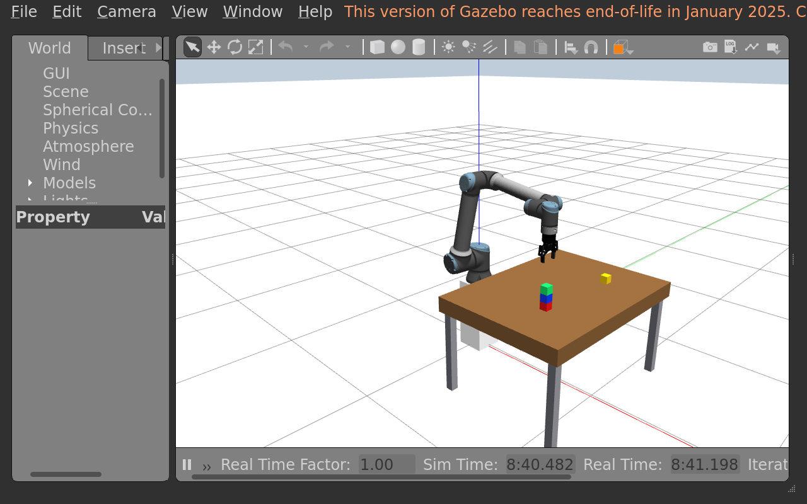
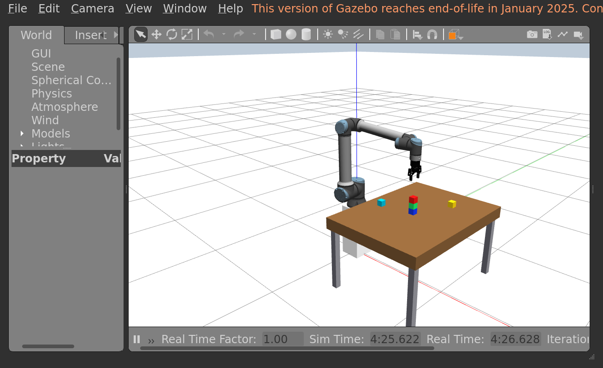

# Tutorial test report — 4 November 2026

**Result:** the functional tutorial workflow passed in a fresh workspace on this
computer. The recorded successful run completed both joint poses and all ten
pick-and-place operations with **no unplanned reset and no skill-level planning retry**.

Test folder: `/home/xander/ur10e-full-tutorial-check`.

## Results by stage

| Tutorial stage | Result |
| --- | --- |
| Download dependencies and extract lab ZIP | Passed; three fresh upstream clones |
| Docker image build | Passed using cached dependency layers |
| Build custom packages | `2 packages finished [6.58s]`; no existing install directory |
| Open the table world | Passed; visible Gazebo table and floor |
| Load robot, controllers and RViz | Passed; ready, no held block or fault; RViz Global Status OK |
| Pose A: Plan, then Execute | Passed; 25 trajectory points; maximum angle error 0.036° |
| Pose B from A: Plan, then Execute | Passed; 25 trajectory points; maximum angle error 0.042° |
| Edit green's JSON position and hex palette color | Passed; three blocks loaded at the edited starting poses |
| Repeat load | Passed; existing live poses preserved |
| Place red, blue and green at chosen coordinates | All three passed, released and verified |
| Add yellow through JSON and move it | Passed; existing objects preserved |
| Red–blue–green tower | Passed; saved screenshot |
| Rearrange into blue–green–red | Passed without resetting between arrangements |
| Add custom hex-color block | Passed; `student_teal`, `#00B8D4`, at `[0.40, -0.10, 0.675]`; five blocks total |
| Repeat final placement | Verified `already_complete=true`; no robot movement |
| Attempt to move covered blue | Correctly rejected with `BLOCK_NOT_TOP` before motion |
| Target X = 1.50 m | Correctly rejected with `INVALID_REQUEST`; no held block |
| Edit an existing starting pose | Load preserved the live tower; restarting applied blue's new `[0.72, 0.0, 0.675]` starting pose |
| Stop with kill, wait and exit | Tested; test container and windows closed |

The final measured red centre was approximately
`[0.699983, -0.049989, 0.774678]` m.

## Corrections included

- Replaced all-six-at-45°/90° goals with separate Pose A/B joint values. Both
  planning and execution returned MoveIt success (1). Plan-only left the arm
  stationary; Execute changed the measured joint positions.
- Tightened smoothing deviation and collision sampling in the custom launch:
  `ompl.path_tolerance=0.001`, `resample_dt=0.05`, and
  `longest_valid_segment_fraction=0.001`. These values were checked in the live
  MoveIt node. Collision checking remains enabled.
- Moved the custom-block example away from red's original JSON starting pose.
  The configuration loader checks spacing between JSON entries as well as
  checking new blocks against live objects.
- Used ordinary ASCII minus signs in the copyable negative radian values.

An earlier attempt on 2 November failed during green transport with
`PLANNING_FAILED`, MoveIt -2, and `holding_block=true` after three rejected plans
(task `9d3846a857aa48b481cfe7de693fae0e`). The paths included table/upper-arm
collisions; no invalid transport was executed. The scene was reset before
further testing. Smoothing deviation was a suspected contributor, not a proven
sole cause. The tighter settings above passed the complete recorded 4 November
sequence. The Humble adapter's default path tolerance is 0.1 rad
([MoveIt source](https://github.com/moveit/moveit2/blob/humble/moveit_ros/planning/planning_request_adapter_plugins/src/add_time_optimal_parameterization.cpp)).

## Reproducible inputs and evidence

Container: Ubuntu 22.04 / ROS 2 Humble, software rendering. Gazebo's window was
resized to 1280 × 800 for a readable view and lower rendering load; the simulation
ran close to real time. Physics, collision and placement checks stayed enabled.

| Dependency | Tested revision |
| --- | --- |
| ros2_SimRealRobotControl | `9645e14a36cd7411871c9572275e6435ab41dac7` |
| IFRA_LinkAttacher | `b056289ba93ccb549db98926dcbb9679642d0c8d` |
| gazebo_ros2_control, humble branch | `42d875b482f0b254d9032950a91b2c5cbd7d1c3d` |

Lab ZIP SHA-256: `b127ee432b1adf8286e1ec8aed9e20c4abfe6cb0a008465aee1803bed50df61a`.
The ZIP package/Docker files match those used in the successful run.

| Evidence | Task ID |
| --- | --- |
| First tower | `00a3239d35cd4f3185e16cf1508602c7` |
| Second tower | `09dcdb8e48b5492f87d063711cea62f5` |
| Final verification with custom color | `ee6d9625c6414881804e47fd3da88f7c` |

Local raw evidence is retained under the test folder:

- `docker-build.log` and `package-build.log`.
- `retest-results/joint-execution.json`: requested and measured joint values.
- `audit-results/events.json`: all placement results and task IDs.
- `retest-results/robot.log`, `world.log`, `final-result.json`, and rejection logs.
- `retest-results/restarted-load.json`: edited starting pose after restart.
- `artifacts/`: per-task JSON reports and screenshots.

## What this test does and does not establish

This verifies the practical ROS/Gazebo workflow and the tested coordinate
sequence on this computer. Docker, Compose, Git, Xauth and VS Code were already
installed, so section 1.1's installation/logout steps were skipped as instructed.
The image build reused dependency cache; this was not a fresh operating-system
installation or an uncached download of every dependency.

The audit used equivalent file edits and MoveIt plan/execute action requests
for the VS Code and RViz exercises. Real Gazebo and RViz windows opened, but
manual mouse clicks, browser extraction, Word submission and typing all six
values in RViz were not automated. Audit helper files stay outside the project
and are not required by students. Other student-selected coordinates and future
upstream changes can still produce planning failures.

This recorded runtime test preceded the checkpoint/question layout revision.
It covers the joint poses, placements and towers above; the later five-block
horizontal-row bonus was not executed in this run.

## Direct Gazebo startup update — 4 November 2026

The tutorial now exports the existing JSON world with
`python3 -m block_skills.geometry CONFIG OUTPUT`, then starts Gazebo directly
with the ROS initialization and factory plugins. `robot.launch.py` still
starts the robot, controllers, MoveIt and RViz. The older world launch remains
available for existing workflows.

This startup was checked in `/home/xander/ur10e-direct-gazebo-test`:

- Fresh custom-package build: `2 packages finished [5.60s]`.
- Direct Gazebo world, ROS state/spawn services, robot and skill readiness: passed.
- Red pick/place: verified success, task `950116f3781c4397ad08e1c697bb95f7`.
- Direct hex-color `extra_block` (`#FF8800`) loaded and moved using the
  tutorial's shell variables: verified success, task `052f0b4e7c53424facbad2f6a4f2275b`.
- All 20 automated checks passed before editing the audit scene.
- The documented `kill -INT` and `wait` commands stopped Gazebo, its server/client,
  MoveIt and RViz; process inspection found no live simulation processes.

Both placement results reported `holding_block=false`. Logs and the second
placement's screenshot remain in the test folder. This additional check covers
the changed startup, grasp/release, two table placements and shutdown.

Updated lab ZIP SHA-256: `b837c1b461aef8bece9fc1feb7f37d767729d4802ecf35a3897052a51245d20b`.

## Exit-only shutdown update — 4 November 2026

The tutorial now ends the Docker session with `exit`, without saved process IDs.
This was tested with direct Gazebo and the robot/MoveIt/RViz launch running and
ready: exiting removed the one-off container and stopped its programs. Re-entering
Docker, sourcing the persistent workspace, starting the simulation and loading
all four saved JSON blocks succeeded. A second `exit` again removed the test
container. Workspace files remained available. Section 3.4 now documents this
container re-entry procedure for applying scene edits.

## Lab ZIP controller-warning fix — 4 November 2026

The Docker build now initializes the optional `antiwindup` flag to `false`
in its copied gazebo_ros2_control source before compilation. The host's
upstream checkout stays unchanged. The earlier warning did not prevent a
successful build; this change gives its exception path a defined default.

Verification for this change:

- Docker image `ur10e:pid-default-fix` (`c22b70c8b59b`) built successfully;
  the controller package's stored compiler stderr is empty.
- Recreated `lab-files.zip`: 30 files, all byte-for-byte identical to the
  corresponding project files, with `compose.yaml` at the archive root.
- Extracted into `/home/xander/ur10e-zip-check-6v3xt60k`; both custom
  packages built successfully and all 20 automated tests passed.
- Isolated headless simulation on ROS domain 84 became ready, with the
  joint trajectory and gripper controllers active.
- Pick/place task `3692c94db2a344e38bd619b807b4eaa6` returned `success=true`,
  `verified=true`, and `holding_block=false`. Requested red centre:
  `[0.82, -0.28, 0.675]`; measured:
  `[0.819985, -0.279985, 0.674898]` metres.
- The temporary test container was removed after completion.

ZIP SHA-256: `be1075eb9cb9e0a52ae48d67be0c6808159a2bee56cf26124dafe293d6d60a60`.

This is a focused regression check of the ZIP/build fix, not another complete
execution of every tutorial exercise or its graphical interactions.
